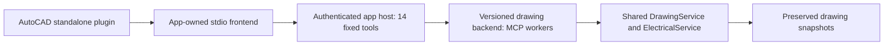

# Shared app framework integration

Version 0.4 adds an experimental app-owned host using `universal-codex-tools==0.17.0` and `universal_tools.framework.ApplicationHost`. Version 0.4.5 binds its dependency artifact to the pushed framework baseline at commit `87157f88de4a5320d2712224216b1e6f18a0ec8d`. Both app and host target **MCP Python SDK 2.3.0**. This is the primary shared-code development path. AutoCAD keeps its independent application, CLI, native compatibility endpoint and standalone Codex plugin. The shared package supplies code for this app-owned host; AutoCAD's standalone plugin is the only Codex integration.



The front door uses the framework's existing search, description, invocation, receipt and session schemas. Its historical `broker_status` tool describes this app host. Backend `drawing-engine` exposes all 31 existing operations plus read-only `cad_get_workflow`. Existing handler schemas, structured results, source checks and durable app receipts remain authoritative. The legacy `serve` command retains its original 31 native definitions.

## Dependency and packaging

Use the exact tested normal package dependency; do not vendor framework source, add a Git submodule or depend on a moving checkout. MCP is pinned at 2.3.0. Setup requires the framework wheel to declare that SDK version and rejects older pins; it never installs an older SDK to accommodate the framework. Windows pywin32 is an explicit app dependency for the existing guarded COM feature. Transitive runtime/development requirements remain hash locked. Coordinated development may explicitly install the framework checkout as an editable dependency in an isolated development environment, but acceptance uses a frozen wheel so concurrent edits cannot alter the test input. Distributed app metadata names the exact package version.

There is no public framework package feed at this checkpoint. Obtain the verified 0.17.0 wheel separately. It is built from [framework commit 87157f8](https://github.com/votecoffee/CodexMCPBroker/commit/87157f88de4a5320d2712224216b1e6f18a0ec8d), with SHA-256 `6387265e9353f69f2dd767e4431ab2c7f6df40dd090118592a01daa3b5946c6b`. This replaces the earlier development snapshot; the same package version alone does not identify equivalent bytes. A later framework artifact needs its own hash update and compatibility assessment. Setup verifies wheel identity, hash, RECORD inventory, SDK requirement and license before caching it under ignored `.local/wheels/` for ordinary dependency installation. An explicit verified wheel atomically replaces an older cached artifact; a failed copy leaves the existing cache intact. Setup reinstalls the locked framework so an unchanged version number cannot retain older installed code. The pip fallback reinstalls the runtime lock:

```powershell
python scripts/framework_dependency.py 'C:\Packages\universal_codex_tools-0.17.0-py3-none-any.whl'
.\InstallAndRun.cmd --framework-wheel 'C:\Packages\universal_codex_tools-0.17.0-py3-none-any.whl' --install-only
```

Manual installation uses `pip install --require-hashes --find-links C:\Packages -r requirements-lock.txt`, then `pip install --no-deps -e .`. Development uses the development lock similarly. A source ZIP does not redistribute the framework wheel or local bindings. Record artifact hashes and dependency versions in private acceptance evidence. An incompatible future SDK/native dependency set requires a separately managed out-of-process host; do not downgrade the app to force a shared environment. No native .NET/NuGet framework binding is assumed.

A limited direct-server import/constructor bridge keeps existing editable 0.3 installations on their already-installed SDK 1.30 usable until an explicitly authorized upgrade. It does not install or select SDK 1.x for new deployments. The new app package and shared host require SDK 2.3.0; the framework host has no older-SDK fallback.

The framework's supported interoperability floor is SDK 2.2; its upstream matrix covers 2.2.0 and 2.3.0. AutoCAD's own dependency remains exactly 2.3.0. The downstream wire contract is the negotiated `2025-11-25` legacy handshake, independent of the SDK package version. SDK 2 Python fields use snake_case; wire serialization uses `model_dump(by_alias=True, mode="json")`, typed pagination and `_meta` for custom extensions. The framework captures retained connection identity across request-scoped session proxies. AutoCAD adds no owner ID argument or custom form/progress relay: the framework keeps those routes bound to the initiating request. There is no app form workflow or chat-settings permission adapter here, and no published .NET binding. SDK 1.x is outside the framework acceptance contract; the direct import bridge only avoids changing an existing installed endpoint during source alignment.

## Framework 0.17 profile

AutoCAD publishes a transient backend with explicit `protocol_mode: legacy`, `watch_catalog: false` and a zero discovery-cache TTL. Framework 0.17's modern features are opt-in; upgrading this dependency does not enable them or migrate an installed frontend.

| Feature | AutoCAD profile |
| --- | --- |
| Modern discovery and `2026-07-28` wire revision | Off; the legacy handshake remains selected. |
| Ownership | App-owned frontend affinity and explicit drawing targets; no model argument or `clientInfo` supplies identity. |
| Approval continuations | No app form/continuation workflow is enabled. Existing app authorization, source checks and uncertain-outcome handling remain authoritative. |
| Watched catalogs and retained discovery caches | Off for this transient backend. Invocation definitions and effects are still checked afresh. |
| SSE response budgets | Backend workers use stdio. The host frontend retains existing HTTP budgets and the library's unbounded SSE event default. |
| Diagnostics | Process-local aggregate counters and fixed-stage tracing; AutoCAD configures no exporter. Metrics are not operation receipts or proof of native completion. |
| Skill resources | No `SkillCatalog` package is selected. Native skill packaging remains independent and needs installation/reload. |
| Tasks and verified downstream skills | No `TaskExtension`, `TaskClient` route or `SkillRegistry` is composed. Synchronous drawing operations retain their existing receipts and recovery contracts. |
| Structural argument budgets | Depth 64 and 100,000 nodes, checked before schema validation, write claims and backend dispatch; byte/transport limits remain independent. |
| Native resources, prompts and completions | No `ProtocolRelay` sources are selected. Drawing context and credentials remain app-owned; no implicit federation is enabled. |
| MCP Apps | No UI extension or iframe resource is composed. Existing text and structured drawing results remain available. |
| Remote OAuth and service credentials | The selected host stays on authenticated literal loopback. No remote endpoint, token provider, PKCE, workload grant or DPoP key is configured. |
| Process ownership and Redis | One process owns the app host, journals and resource reservations. Replicated deployments are rejected. No Redis extra, shared Task repository or subscription bus is installed. |

The app host also exposes the framework's read-only `broker://catalog` resource containing only a public generation identifier. Its historical URI and `broker_status` tool name belong to the shared framework API; neither registers an external route. Protocol fixtures check that this resource changes after an explicit backend refresh while the fourteen tool definitions stay fixed. They do not establish subscription display or native Codex skill activation. See the [upstream feature contract](https://github.com/votecoffee/CodexMCPBroker/blob/87157f88de4a5320d2712224216b1e6f18a0ec8d/docs/sdk2-features.md) before assessing any future opt-in.

Framework 0.17's extension lifecycle is supplied by `ExtensionServer` inside the shared surface. AutoCAD selects no extensions or live skill providers, so that lifecycle does not create job stores, discover skills or execute contributed code. The existing native plugin skill remains the app entrypoint. Skill import profiles and live publication do not establish native host activation.

Tasks would need an actual app-owned job adapter with durable handles, current authorization on polling/result reads, source/review revision bindings, cooperative cancellation and lost-start reconciliation without replay. Existing index/preview/export calls are not automatically converted to Tasks. Task notifications would require owner-authorized subscriptions and explicit readback after reconnect; URL acceptance would acknowledge navigation only, with authentication or completion verified separately by the app. Likewise, future skill federation would require explicit trusted origins, complete manifest verification and app-owned activation consent. See the [extension contract](https://github.com/votecoffee/CodexMCPBroker/blob/87157f88de4a5320d2712224216b1e6f18a0ec8d/docs/extension-development.md). Installing this dependency preserves the selected standalone frontend; optional features require separate app integration.

The [deployment contract](https://github.com/votecoffee/CodexMCPBroker/blob/87157f88de4a5320d2712224216b1e6f18a0ec8d/docs/deployment.md) distinguishes concurrent clients of one owning host from replicated native SDK servers. AutoCAD's SQLite receipts, native drawing sessions and process-local coordination do not implement the shared jobs, receipts and fencing needed by replicas. A durable task handle or SDK continuation would not make that state portable. Keep one owning host per app state, with explicit route selection and no native-effect retries or failover.

## Publish and run an isolated app host

Use disposable drawings and a separate configuration during assessment. The following commands are explicit local administrative operations, not model tools:

```powershell
python -m autocad_mcp --config .local/test-config.json framework-prepare --host-state .local/test-framework --port 8798
python -m autocad_mcp --config .local/test-config.json framework-serve --host-state .local/test-framework
```

The host state must be separate from source roots, app business state and other applications' service registrations. `framework-prepare` initializes private bearer-protected loopback settings, snapshots app code into immutable content-addressed deployments and atomically publishes the selected backend. It does not start a native application, install a plugin, change live registrations or migrate a workflow. Highlighting is excluded from the default write allowlist; `--include-highlighting` is an explicit additional policy choice requiring separate native acceptance.

In another process, `python -m autocad_mcp framework-proxy --host-state .local/test-framework` runs the app-owned stdio frontend against that already-running host. It does not start a universal daemon. Each frontend retains independent framework affinity; targets and results remain intentionally shared app state rather than private per-chat documents.

To prepare the standalone plugin for an authorized future framework pilot:

```powershell
python scripts/install_plugin.py --prepare-only --config .local/test-config.json --frontend framework --host-state .local/test-framework
```

This only generates private bindings. Explicit later standalone installation uses the same options without `--prepare-only`. Do not run it as part of source compatibility work. Existing install choices are preserved; default installer bindings remain on the legacy endpoint until an explicitly authorized pilot selects the framework frontend. Setup provides no external registration or aggregation route.

## Publication and recovery boundaries

Changing backend code or live workflow metadata requires a new content-addressed deployment. After quiescence and receipt reconciliation, repeat `framework-prepare` and call `refresh_services` on the same connected app frontend. Re-describe changed tool revisions. Backend additions and workflow read content can then change without modifying the fourteen native front-door schemas. Native skill/schema changes still require plugin installation and Codex reload. Runtime, identity and startup-instruction changes require host restart/reconnection.

The publication pins its entrypoint and deployment manifest. Every backend and nested extraction/render/table/highlight worker verifies all snapshotted app files, the selected config bytes, Python version and key dependency versions before importing handlers. Nested workers stay on that publication rather than resolving a newer editable app. App source edits cannot silently alter an already-published backend. This does not authenticate artifacts or hash the entire installed native/transitive dependency closure; retain normal package/install controls and native acceptance.

Use one selected route throughout an operation. Host and app write IDs/receipts are separate. The host's completed receipt means the MCP call returned; the app result may still report an uncertain native effect. App-owned publication and refresh therefore also check the inner app journal. Any non-successful app receipt blocks refresh/publication; generic framework uncertain/app-error and ownership barriers remain in force too. No automatic acknowledgment, retry, route failover or model-facing recovery override is supplied. App reconciliation/admin controls for resolving historical non-successful receipts remain future work; preserve direct read/audit access and involve the local operator. Restarting cannot establish rollback or completed native work.

## Validation and remaining gaps

`tests/test_framework.py` uses real AutoCAD handlers with synthetic DXF/PDF inputs and private state. It compares legacy tool schemas/results, preserves original bytes, exercises app-state writes and separate receipts, rejects altered deployment/configuration bytes, and checks unknown inner outcomes. Two unchanged native MCP sessions discover a new disposable backend operation and revised workflow after refresh while their fourteen front-door definitions remain identical. A deliberately changed parser also executes through the snapshot's nested worker. A separate stdio app frontend runs without an external daemon or plugin.

The selected backend is transient and stateless: targets are explicit, snapshots/receipts are durable and no private native document session is retained. Framework calls to one backend remain serialized. Disposable warm-inspect benchmarks record direct service versus transient-host latency; process initialization adds material overhead, commonly seconds for small cached reads. These measurements do not establish native/host performance acceptance. A future retained/shared profile needs app-owned quiescence and retirement controls before it can improve that lifecycle safely.

Actual Codex activation, multi-chat selection/lifetimes, UI/media display, live AutoCAD highlighting, native acceptance, recovery/admin UX, complete deployment dependency closure remain unassessed. The current app has no form-approval workflow to migrate and no adapter for Codex chat approval settings. Model arguments cannot override app policy. This checkpoint is source/package and isolated protocol alignment, not permission or evidence to migrate an installed workflow.
